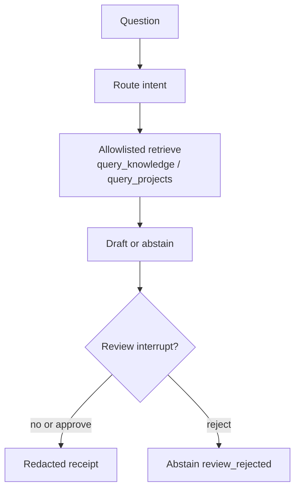

# How Harbor is wired

Harbor is a small loop: route a question, retrieve from two labelled indexes, draft or abstain, optionally pause for review, then write a redacted receipt.

The framework-free pipeline is the control. LangGraph is a wrap of those same functions. If the graph disagrees with the baseline on the fixture suite, the graph is wrong.

## Nodes

The LangGraph wrap uses five named nodes: `route`, `retrieve`, `draft`, `review`, `emit_receipt`.

| Node | What it does | Fail closed when |
|---|---|---|
| `route` | knowledge, project, or federated | scopes must match intent |
| `retrieve` | two labelled tools only | unknown or write-shaped names |
| `draft` | extractive default; Ollama/hosted optional | missing provider, invented citation paths, injection |
| `review` | optional interrupt | approve still cannot add tools |
| `emit_receipt` | hash of paths, cited-file bytes, corpus manifests, version, outcome, tools, provider | question text, snippets, planted secrets, a citation with no source digest |

Federated questions query both indexes. They never return one unlabelled list. That split is a type invariant, not a prompt instruction.

## What the receipt binds

The receipt hash still covers the request id, route, outcome, citation paths, tools and provider. It now also covers three bindings:

- `cited_source_sha256`: the sha256 of the raw bytes of each cited note, in the order of `citation_paths`.
- `corpus_digests`: one digest per index that was searched. It hashes every note's path and byte hash in that index, so editing any note there moves it, cited or not.
- `implementation_version`: `grounded_agent.__version__` when the receipt was built. `receipt_schema` names the hashed layout.

`build_receipt` raises if a cited note has no digest. It also raises if the serialized receipt contains the question, a sentence of 16 characters or more from any retrieved snippet or from the text of an answered response, or a planted secret.

Two limits. `implementation_version` is the declared package version, so two unreleased commits with the same version are not told apart. The corpus digest binds the fixture corpus that was searched, not whether the answer is true.

## What is outside this diagram

Ollama and hosted sit behind `--provider`. They are not in the default path.

The Harbor MCP server exports the same two read-only tools. Handlers are synchronous FastMCP functions. I did not wire asyncio, Celery, or Temporal here. The allowlist, schema, and timeout are the contract I would keep if retrieve moved onto async handlers or a worker so a one-thread pool does not starve under concurrent MCP calls. Live MindGraph is a fail-closed adapter and is not enabled in CI.

Temporal, Airflow, Prefect, and n8n are a mapping note, not boxes in this graph. See [`workflow-portability.md`](workflow-portability.md).

## Proof

`tests/test_graph.py` checks that baseline and graph fixture decisions match, including receipt hashes. `tests/test_receipt_binding.py` checks that editing a cited note, an uncited note in the same index, or the version moves the hash. `grounded-agent demo` reruns the reviewer cases, including that graph match.
